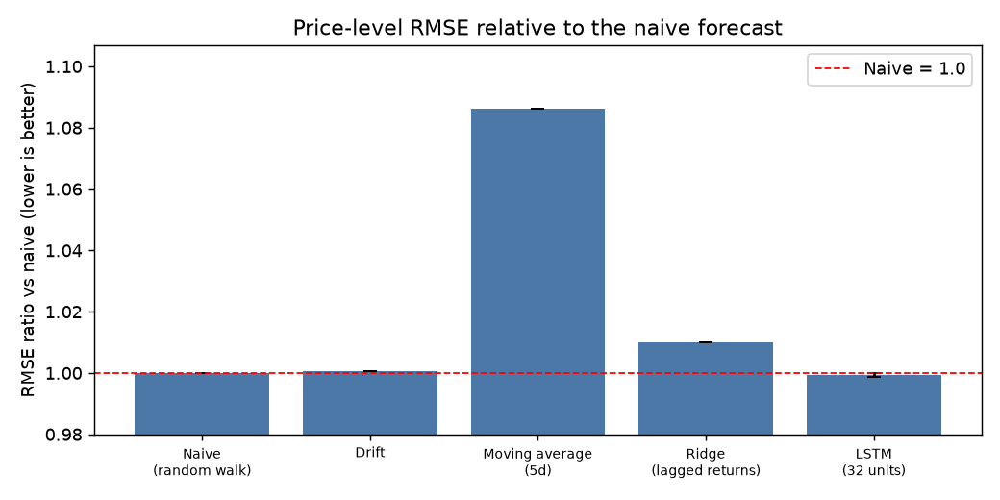
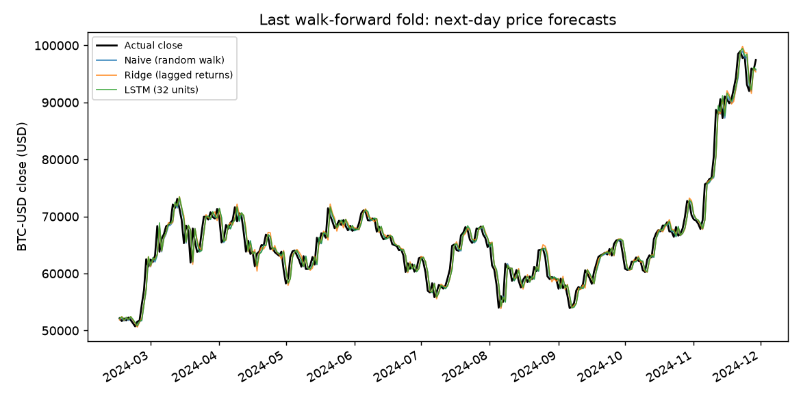

# Bitcoin Next-Day Forecasting: LSTM vs. Naive Baselines

[](https://github.com/anindya127/Bitcoin-Price-Prediction-Using-LSTM/actions/workflows/ci.yml)


A small, reproducible benchmark that asks whether a Keras **LSTM** can forecast the next-day BTC-USD price
better than trivial baselines. It uses **walk-forward (expanding-window) evaluation** on daily data, predicts
**log returns** rather than price levels, and judges every model against the **naive "tomorrow = today"
forecast**. Everything runs offline from a committed price snapshot (2015-01-01 to 2024-11-29, 3,621 daily rows).

## Results

Pooled over 5 walk-forward test folds (2021-01-06 to 2024-11-29, 1424 days). Mean ± std over 5 seeds for the LSTM; the other models are deterministic (std 0).

| Model | RMSE (USD) | MAE (USD) | RMSE ratio vs naive | Dir. accuracy (%) | DM p-value vs naive |
|---|---|---|---|---|---|
| Naive (random walk) | 1,439 ± 0 | 945 ± 0 | 1.000 ± 0.000 | n/a | - |
| Drift | 1,440 ± 0 | 947 ± 0 | 1.000 ± 0.000 | 49.9 ± 0.0 | 0.798 |
| Moving average (5d) | 1,563 ± 0 | 1,083 ± 0 | 1.086 ± 0.000 | 45.4 ± 0.0 | <0.001 |
| Ridge (lagged returns) | 1,454 ± 0 | 963 ± 0 | 1.010 ± 0.000 | 49.5 ± 0.0 | 0.121 |
| LSTM (32 units) | 1,438 ± 1 | 951 ± 1 | 0.999 ± 0.001 | 50.0 ± 0.2 | 0.806 |

Share of up-days in the test period (accuracy of 'always up'): 49.9%.

Per-fold test windows:

| Fold | Train days | Test days | Test period |
|---|---|---|---|
| 0 | 2136 | 284 | 2021-01-06 to 2021-10-16 |
| 1 | 2420 | 284 | 2021-10-17 to 2022-07-27 |
| 2 | 2704 | 284 | 2022-07-28 to 2023-05-07 |
| 3 | 2988 | 284 | 2023-05-08 to 2024-02-15 |
| 4 | 3272 | 288 | 2024-02-16 to 2024-11-29 |

<p align="center">
  
  
</p>

**How to read this**

- **No model beats the naive forecast in a meaningful way.** The LSTM's pooled RMSE ratio is 0.999 ± 0.001 and
  its Diebold-Mariano p-value is 0.81: statistically indistinguishable from "tomorrow = today". Per fold it is
  slightly better in some folds (0.994-0.999) and slightly worse in others (up to 1.012); no fold-level win is large.
- **Ridge and the 5-day moving average are worse than naive** (ratios 1.010 and 1.086). The moving average
  is significantly worse (DM p < 0.001): recent returns carry no useful signal for the next day.
- **Directional accuracy is about 50% for everything** (LSTM 50.0 ± 0.2%, up-days are 49.9% of the test
  period). That means no tradable edge. Naive has no direction (it always predicts zero change), hence n/a.
- **The LSTM tracks the price closely only because yesterday's price is already a good forecast.** In the
  figure its curve is the actual curve shifted one day, the same as the naive line.
- Daily BTC returns are close to a random walk, so this outcome is the expected finding, not a failure to tune.
  No hyperparameters were tuned and no seeds or folds were selected.

## Evaluation protocol

| Item | Choice |
|---|---|
| Target | Next-day log return `log(close[t+1]/close[t])`; converted back to price as `close[t] * exp(r)` for USD metrics |
| Features | The previous 60 daily log returns |
| Splits | Expanding-window walk-forward: first 60% of samples are the initial training set, the remaining 40% is cut into 5 consecutive test folds; each fold trains on everything before it |
| Leakage control | Standardiser fitted on each fold's training part only; test windows always lie strictly after the training windows |
| Early stopping | LSTM only: last 10% of the training part is held out as validation; weights restored from the best validation epoch |
| Seeds | 5 seeds (0-4) for the LSTM (`keras.utils.set_random_seed`); the other models are deterministic |
| Metrics | RMSE and MAE in USD and on returns, directional accuracy, share of up-days, RMSE ratio vs naive, Diebold-Mariano test on squared price errors vs naive |

## Models

- **Naive**: predicted return 0 (tomorrow's price = today's). The bar every other model has to clear.
- **Drift**: mean training return.
- **Moving average**: mean of the last 5 returns.
- **Ridge**: ridge regression (alpha 1.0) on the 60 lagged returns.
- **LSTM**: one LSTM layer (32 units), dropout 0.1, dense output, Adam (1e-3), batch 64, at most 30 epochs, early stopping (patience 5).

## Quick start

```bash
git clone https://github.com/anindya127/Bitcoin-Price-Prediction-Using-LSTM.git
cd Bitcoin-Price-Prediction-Using-LSTM
python -m venv .venv && source .venv/bin/activate
pip install -e ".[dev,tf]"
pytest -q
python -m btc_forecast run                 # full benchmark, writes results/ and docs/
python -m btc_forecast run --no-lstm       # baselines only, no TensorFlow needed
python -m btc_forecast run --download      # optional: fresh data via yfinance (pip install -e ".[download]")
```

The full run (5 seeds, 5 folds, LSTM) took 489 s on a 4-core CPU without a GPU.

## Project layout

```
btc_forecast/   data.py (returns, windows, walk-forward folds), models.py, metrics.py,
                benchmark.py, plots.py, cli.py
data/           btc_usd_daily.csv (committed snapshot)
results/        btc.json (all per-seed, per-fold numbers), btc.md
docs/           figures
tests/          pytest suite on synthetic random walks and AR(1) data (no internet needed)
legacy/         original notebook, kept for reference
```

## Limitations

- **One asset, one period** (BTC-USD, 2015-2024). Results say nothing about other assets or regimes.
- **Only past returns as inputs.** No volume, on-chain, macro or sentiment features were tried.
- **Small, untuned LSTM** (32 units, no hyperparameter search), chosen to keep CPU runtime low. A bigger or tuned
  model might differ, though with ~0 predictable signal in daily returns there is little to find.
- **Transaction costs, slippage and position sizing are ignored.** Directional accuracy near 50% means there is
  no tradable edge even before costs.
- **Multi-day forecasting is not evaluated.** Recursive multi-step forecasts compound error and are not reported.
- Test folds are ~284 days each, so per-fold differences of ±1% in RMSE are within noise.

## License

MIT, see [LICENSE](LICENSE).
